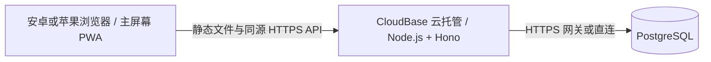

# 阅读打卡 APP 架构设计

> 需求来源
> - [阅读打卡 APP 当前已确认 PRD](../requirements/阅读打卡%20APP.md)
>

## 设计摘要

使用 React、TypeScript、Vite 构建 PWA。腾讯云 CloudBase 云托管运行 Node.js / Hono，同源提供静态页面和 API，PostgreSQL 保存业务数据。目标为本人和少量朋友在安卓和苹果手机使用。通过唯一昵称和密码登录，打卡在线提交，离线保留草稿并由用户手动重试。

## 架构驱动因素

- 使用腾讯云 CloudBase，保持免费计划，生产配置固定 HTTPS origin。
- 安卓和苹果共用网页，通过浏览器或主屏幕打开，适配窄屏、安全区域和软键盘。
- 每笔有效打卡保留，同日允许回退至前日累计值，跨日及跨周由后端统一计算。
- 每人最多一位好友，绑定及解除需原子完成，好友数据只读。
- 昵称用于登录，书籍和关系关联稳定用户 ID。更换昵称或密码后继续访问原有数据。
- 页码严格对齐色块底边，前台自动同步好友进度。

## 技术决策与权衡

| 关注点 | 选择 | 驱动理由与代价 |
|---|---|---|
| 客户端 | React + TypeScript + Vite PWA，CSS 绘制进度条 | 双平台共用网页，直接发布更新。安装入口和设备验证依赖浏览器能力，需真机验证 |
| 托管和 API | CloudBase 云托管 + Node.js / Hono，同源部署 | 同一容器提供静态资源和 API，统一配置 Cookie 与域名 |
| 数据库 | 单个 PostgreSQL 数据库，使用版本化 SQL 迁移 | 用条件写入、唯一约束、触发器与事务维护一致性 |
| 身份 | 唯一昵称与密码 | Node.js 通过 scrypt 派生密码摘要，数据库保存独立盐及摘要。在目标环境实测认证耗时 |
| 登录状态 | 数据库会话及同源 HttpOnly Cookie | 浏览器管理会话，页面脚本无法读取令牌。写操作须防跨站请求 |
| 数据加载 | TanStack Query，首页可见时每 15 秒刷新 | 减少免费额度消耗，代价为可见同步延迟。本人提交后及回到前台立即刷新 |
| 离线 | Service Worker 缓存应用静态外壳，sessionStorage 保存本人打卡草稿 | 支持同标签页刷新后找回输入。首版不自动提交离线记录，关闭标签页可能丢失草稿 |

免费共享 PostgreSQL 通过 CloudBase HTTPS 网关执行事务批次，网关函数仅供服务端角色调用。支持 PostgreSQL 协议直连的环境可由 Node.js 连接池在同一连接上执行事务。本地开发和回归测试使用 PGlite（本机运行的 PostgreSQL），执行同一套 SQL 迁移和网关函数。

## 系统设计

| 模块 | 职责与数据所有权 | 依赖方向 |
|---|---|---|
| identity | 用户、头像、密码凭据、限流和会话 | 数据库 |
| reading | 书籍、打卡、每日有效值、完成状态、周进度 | identity 用户 ID |
| friendship | 关系历史、有效成员、好友读取授权 | identity 用户 ID 与好友邀请码解析 |
| home | 组合本人和当前好友的首页快照，不拥有业务表 | identity、friendship、reading |
| web | 页面、弹窗、双栏选书、PWA 外壳、草稿和请求状态 | API 契约 |

业务模块拥有自己的写入和数据库触发器，home 单向调用只读查询。好友授权与数据读取在同一条 SQL 中完成，避免解绑发生在权限检查与数据读取之间。

## 数据与接口

| 数据 | 核心字段和约束 |
|---|---|
| users | UUID、昵称、内置头像标识、唯一随机好友邀请码、created_at |
| profile_avatars | 每位用户一张头像，保存 JPEG 和图片版本 |
| password_credentials | 用户 ID、Unicode NFKC 规范化并转小写的唯一昵称键、随机盐和密码摘要 |
| sessions | 随机令牌摘要、user_id、expires_at、revoked_at。密码会话使用独立 Cookie 和用途 |
| auth_attempts | 入口及限流范围、时间窗、尝试次数 |
| books | owner_id、书名、正整数 total_pages、revision、initial_page、current_page、completed_on、created_at、deleted_at、创建请求幂等键 |
| check_ins | book_id、reading_date、page、recorded_at、expected_revision、书内序号、request_id、请求摘要；只追加 |
| daily_progress | book_id 与 reading_date 联合唯一、effective_check_in_id；可由 check_ins 重建 |
| friendships | ID、两个不同用户 ID、created_at、ended_at |
| active_friendship_members | user_id 主键、friendship_id；一条有效关系对应两位成员 |

时间戳保存 UTC，业务日期保存 YYYY-MM-DD。current_page 与 completed_on 是 reading 的事务内投影，每日最终值以 daily_progress 指针为准。被当日更正替代的历史页码不作为编辑总页数的下限。外键不级联删除打卡历史。

索引覆盖用户书籍查询、书籍日期及序号、唯一昵称键、会话摘要、邀请码、关系成员。用查询计划和执行耗时评估 PostgreSQL 查询成本。

### API 契约

统一使用 /api/v1、JSON、同源 Cookie。身份从会话取得，客户端不能指定写入的 owner_id。

| 接口 | 输入与结果 |
|---|---|
| POST /auth/register | 昵称和密码，原子创建账号和会话 |
| POST /auth/login | 昵称和密码，成功后设置会话 Cookie |
| DELETE /auth/session；GET /me | 撤销当前会话；读取本人资料、邀请码和关系状态 |
| PATCH /me/nickname、/me/password | 更新本人登录昵称，或验证当前密码后更新密码及会话 |
| PUT /me/avatar；GET /avatars/:id | 更新本人头像。图片仅允许本人及绑定好友读取 |
| GET /home；GET /books | 本周双人首页；本人未删除的全部书籍 |
| POST /books；PATCH、DELETE /books/:id | 创建携带初始已读页数且幂等，修改携带 expectedRevision，删除为软删除 |
| POST /books/:id/check-ins | page、expectedRevision、expectedDate、requestId，返回已接受记录和最新书籍状态 |
| POST /friendship；DELETE /friendship/:id | 邀请码绑定；指定关系解除，重复解除幂等 |

401 表示会话失效，404 隐藏无权访问资源，409 表示版本、日期或绑定冲突，422 表示输入无效。配额或网络失败显示暂时不可用，保留草稿，不能伪造成功。相同 requestId 与相同输入返回原记录，携带不同输入则拒绝。

/home 返回 serverNow、timeZone、weekStart、关系 ID、双方展示资料、书籍 revision、周初页码及每日有效页码。好友只收到当前可展示书籍与进度。

## 关键流程

### 密码登录与个人资料

注册不收取准入码。昵称键唯一约束、建号、密码凭据和会话写入同批事务。架构切换通过版本化迁移创建密码凭据表并移除旧通行密钥相关表。旧身份记录不参与登录或新的好友绑定。

密码使用 Node.js 的 scrypt，参数为 N=16384、r=8、p=5，盐为每个密码独立生成的 128 位随机数。登录使用定长摘要的常量时间比较。所有认证请求使用入口级限流，登录和修改密码另按账号限流。密码不进日志、持久缓存或数据库明文。

修改昵称同批更新唯一登录键和展示昵称。修改密码验证当前密码，随后在同一事务内条件更新摘要、撤销已有会话并创建当前会话。后续写入以本次新摘要为条件。登录写入会话前再次匹配已验证的昵称键和密码摘要，以防并发修改后旧凭据仍能登录。

Cookie 使用 Secure、HttpOnly、SameSite=Lax、Path=/ 和 __Host- 前缀。写操作要求 Origin 匹配当前请求地址及固定配置，并校验 JSON Content-Type。本地开发使用固定的回环地址。会话令牌只存摘要，认证响应使用 no-store。预览环境使用独立数据库和固定 origin。

### 头像上传

未上传照片的本人和朋友使用同款默认头像。「我的」个人卡片提供上传入口。浏览器选择图片后居中裁切并导出为 256×256 JPEG。数据库存储一份当前图片，限制为 120 KiB，更新时更换版本。个人资料和首页只返回图片版本，图片请求在同一主库查询中校验本人或当前好友权限，并采用 no-store。

### 打卡、编辑与事务

写入采用参数化条件 SQL 和必要的数据库触发器。应用侧预校验用于反馈，数据库内校验作为最终裁决。零行修改本身不会触发回滚，因此所有依赖写入须由已成功的记录驱动。

建书把初始已读页数写为历史起点和当前页码，范围为 0 到总页数。它代替首条打卡前的零页下限并参与总页数修改校验。原有书籍的初始已读为 0。初始已读等于总页数时记为创建当日已完成。

打卡先查询本人相同 requestId，已存在则核对摘要返回结果。新的 INSERT ... SELECT 只在书籍属于本人、未删除且 revision 匹配时产生记录。BEFORE INSERT 触发器校验累计页码、前一日有效下限、总页数和业务日期，违反时拒绝写入。书内序号取当前 revision + 1。

AFTER INSERT 触发器更新 daily_progress、books.current_page、completed_on 和 revision。插入及触发器属于同一事务，任一步失败则整体回滚。并发重复 requestId 由唯一约束兜底，冲突后读取已存在记录。零行插入返回冲突且不修改投影。

编辑采用所有者与 revision 条件 UPDATE，总页数至少为所有每日有效值的最大值。触发器维护完成状态，增加总页数可恢复在读；缩小至当前页码以编辑日期完成。软删除同样做版本比较并保留历史。单纯改书名不重置完成日期。有关完成日期的解释沿用前版设计假设。

业务日期以数据库执行时的北京时间为最终依据，expectedDate 不一致时拒绝新提交。已成功请求跨日重试返回原结果。客户端跨日保留草稿但要求用户刷新后明确提交新日期，不回填昨天。

### 好友关系与同步

绑定在一个 batch 中创建关系并插入两条有效成员记录，user_id 主键使任何一位已绑定都导致整批回滚。禁止自绑定，所有写入绑定本次认证用户和解析出的目标 ID，关系恰好两位成员。相同双方重复请求读取当前关系并返回。

解除在一个 batch 中按关系 ID 与当前用户成员资格条件结束关系并删除两位有效成员。后续语句必须依赖同批已结束的该关系，不能删除新建立的关系。好友读取使用主库授权 SQL，首版不启用读副本。

首页每 15 秒前台刷新，隐藏或离开首页暂停，同一标签页只允许一个请求在途。提交成功、回前台及网络恢复后立即刷新。绑定发起者成功后自动返回首页并立即刷新。解除者立即清空右栏，好友在下一次成功刷新时清空；已经下发的内容无法远程撤回。关系变化、登出及好友请求失败清除好友内存缓存，并丢弃过期请求响应。

### 周进度与 PWA

周一零点开始一周，首页筛选“未删除且仍在读，或完成日期属于本周”。跨周改变查询边界，无需搬迁记录或周期任务。当天更正低于总页数清空完成日，重新完成时重新计算。未打卡日期继承之前累计值。

总高度 H、总页数 T 时，页码 p 的坐标为 H×p/T；色段 [a,b] 顶部为 H×a/T、高度为 H×(b-a)/T，页码文字垂直中心与色段底边共用 H×b/T。零增量无色段，总页数标签重合时去重。按星期固定七色，初始及历史已读用灰色，未读用带描边和内阴影的白色。进度条在卡片中水平居中。密集标签可放大并滚动进度区域，不能单独偏移标签。

左右分别持有 selectedBookId，刷新只在原书籍消失时重选；白色未读区打开打卡弹窗。当天读完后，可点击当天新增区间更正。提交成功关闭弹窗并更新进度。首页顶部留空，底部三入口按 PRD。适配 safe-area、软键盘和动态视口高度，验证横滑不会误触打卡。

配置 manifest 的稳定 id、start_url、scope、standalone、图标和主题色，以及苹果主屏幕图标。安装说明放在「我的」。

Service Worker 只缓存版本化应用外壳，API、认证、好友数据采用网络请求且 no-store。新版本准备好时提示用户刷新，保留当前草稿。草稿包含用户、书籍、页码、原日期、revision 和 requestId，按用户隔离，登出清理；恢复联网展示草稿并等用户确认。收到成功后删除，409 时刷新状态后生成新请求。

## 腾讯云部署与验证

云托管容器在 8080 端口同源发布静态文件和 API，使用 /healthz 做健康检查。/api 与 /api/* 由 API 路由处理，未知 API 返回 JSON 404，页面导航可回退到 index.html。部署配置和迁移步骤见 [README](../../README.md)。

生产和预览使用独立数据库和固定 HTTPS origin，数据库访问凭据仅配置在服务端。保持免费计划，不自动升级付费。15 秒刷新约产生每个前台客户端每小时 240 次首页请求；用请求数、错误率和查询耗时观察运行情况。禁止每次轮询续写会话。定期备份数据库并验证恢复。

用本地 PostgreSQL 回归测试检查事务、触发器、权限和冲突处理。在独立腾讯云预览环境验证批量事务回滚、零行更新、并发绑定、重复提交和并发密码修改，并测量注册、登录和修改密码的实际耗时。不得为缩短认证耗时降低密码哈希强度。

用安卓 Chrome、苹果 Safari 和各自主屏幕模式验证注册、登录、个人资料修改、两人打卡、断网草稿、跨日、跨周、完成后更正、总页数修改、解除授权及布局。浏览器清理数据或关闭标签页会影响草稿，不能承诺设备永久保存。

## 实现约束、假设与演进

前端位于 apps/web，API 和业务模块位于 apps/tencent/api，接口契约位于 packages/contracts。腾讯云入口与 PostgreSQL 迁移位于 apps/tencent。
- 用户已确认 PWA 双平台、少量朋友、昵称密码、联网提交。
- 北京时间仍为沿用设计假设。首次运行前配置固定业务时区，正式历史产生后变更须定义迁移规则。
- 15 秒刷新、同标签页草稿及密码修改后撤销旧会话是本次工程决策。
- 认证耗时、设备兼容性和目标网络的可达性均需实际部署验证，当前文档不代表已经测试通过。
- 若刷新延迟无法满足需求或轮询占用明显，再评估推送同步。产品若要求离线自动提交，需先定义日期与多设备冲突规则。

## 需求覆盖

| 需求 | 架构落点 |
|---|---|
| R-001 | identity、昵称密码、个人资料、同源会话及 /me |
| R-002 | reading、书籍接口、条件写入、软删除和编辑触发器 |
| R-003 | web、双栏独立选择、空状态、三入口及顶部留空 |
| R-004 | 追加打卡、daily_progress、幂等及数据库原子更新 |
| R-005 | 周快照、完成日期投影、共用几何坐标 |
| R-006 | friendship、成员唯一约束、授权 SQL 和前台刷新 |
| R-007 | PWA manifest、静态外壳、双平台浏览器与主屏幕验证 |
| R-008 | 用户隔离草稿、手动重试、请求幂等与跨日校验 |
| 横切约束 | 历史保留、权限与用户身份、免费额度监测 |
